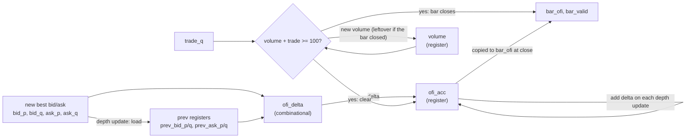

# OFI accumulator in VHDL

A small hardware block that receives order-book updates and trades, one event per clock cycle, and outputs the **order flow imbalance (OFI)** of each volume bar. Written in VHDL, simulated in Questa, synthesized in Quartus.

The OFI definition follows Cont, Kukanov and Stoikov, "The Price Impact of Order Book Events", *Journal of Financial Econometrics* 12(1), 2014, 47-88.

## What it computes

For each depth update (best bid and best ask, each with a price and a quantity), compare the new book with the previous one:

| | price moved toward the spread | price unchanged | price moved away |
|---|---|---|---|
| Bid part | up: `+bid_q` | `bid_q - prev_bid_q` | down: `-prev_bid_q` |
| Ask part | down: `+ask_q` | `ask_q - prev_ask_q` | up: `-prev_ask_q` |

Contribution of one update = bid part - ask part. The OFI of a bar is the sum of the contributions inside it.

A bar closes when the traded volume reaches the threshold. The block then outputs the bar's OFI, resets the total, and keeps any leftover volume for the next bar.

Rules the design follows:

1. One event per clock cycle (either a depth update or a trade).
2. The first depth update after reset only loads the "previous" registers.
3. Depth updates only count after the first trade has opened a bar.
4. A bar closes when volume reaches or passes the threshold (`>=`).
5. The unfinished bar at the end is never output.
6. Assumes every trade is smaller than one bar.

## Design

Two files:

- `ofi_delta.vhd` is combinational. From the previous and new best bid/ask it computes the contribution of one update. No clock, no memory.
- `ofi_bar.vhd` is clocked. It holds the previous book, a running OFI total, a volume counter and two flags (`have_prev`, `bar_open`), and uses `ofi_delta`.



### Ports of `ofi_bar`

| Port | Direction | Meaning |
|---|---|---|
| `clk`, `rst` | in | clock and synchronous reset |
| `ev_valid` | in | an event is present this cycle |
| `ev_is_trade` | in | 1 = trade, 0 = depth update |
| `bid_p`, `bid_q`, `ask_p`, `ask_q` | in | best bid/ask price and quantity (8 bits each) |
| `trade_q` | in | trade quantity (8 bits) |
| `bar_valid` | out | one-cycle pulse when a bar closes |
| `bar_ofi` | out | OFI of the closed bar (16 bits, signed) |

Test configuration: 8-bit prices and quantities, volume threshold 100.

## Verification

`ofi_delta` has a directed testbench (`tb_ofi_delta.vhd`) with 7 hand-computed cases.

`ofi_bar` has a self-checking testbench (`tb_ofi_bar.vhd`) that sends 13 events (depth updates and trades) and checks the output of three bars against hand-computed values (30, -80, 45). It covers: depth updates before the first trade, bars that close exactly at the threshold, price moves in both directions, and a price move on both sides at once.

I also checked that the tests detect mistakes by deliberately breaking the design, some of the breaks where:
- Changed the `>=` for a `>`
- Gave quantity greater than 100
- Remove the have_prev check
- Changed `+ resize(delta, 16)` to `- resize(delta, 16)`

In this cases the testbench failed.

### Run it (Questa)

```
vcom ofi_delta.vhd
vcom ofi_bar.vhd
vcom tb_ofi_bar.vhd
vsim -voptargs=+acc work.tb_ofi_bar
add wave -r /*
run -all
```

Expected last line: `testbench finished: 3 bars seen`, with no `Error` lines.

For running only `ofi_delta` run:

```
vcom tb_ofi_delta.vhd
vsim work.tb_ofi_delta
run -all
```

## Synthesis results (Quartus Prime Lite 24.1)

| Item | Value |
|---|---|
| Device | Cyclone V 5CGXFC7C7F23C8 |
| Registers | 75 |
| Logic usage | 77 ALMs (under 1% of 56,480) |
| Pins | 61 of 268 |
| DSP blocks | 0 |
| Block memory bits | 0 |
| Fmax (register to register) | 132.96 MHz, with a 10 ns clock constraint |
| Worst setup slack | 2.479 ns (no violated paths) |
| Critical path | `prev_ask_p[7]` to `ofi_acc[15]`: price comparators and formula-select logic in `ofi_delta`, then an adder carry chain into the accumulator |

The Fmax report is for the timing model shown in the Timing Analyzer's report header: Slow 1100mV 85C Model.

Note: input and output paths have no timing constraints in this setup, so the Fmax above only covers register-to-register paths.

## Limitations

- Prices and quantities are 8 bits and the threshold is 100, chosen for easy testing. A realistic version needs wider registers and a larger threshold.
- Level-1 OFI only (best bid and ask), not multi-level.
- The testbench uses a hand-written scenario. It has no random test or reference model cross-check yet.
- Assumes every trade is smaller than one bar.
- The accumulator is 16 bits, which is enough for short tests but not for long bars.
- Not tested on real market data and not run on a physical board.

## Possible next steps

- Pipeline the design and compare Fmax before and after.
- Extend to multi-level OFI.
- Add a Python reference model and compare thousands of random events.
- Run on a board with a simple input method.

## Reference

R. Cont, A. Kukanov, S. Stoikov (2014). The Price Impact of Order Book Events. *Journal of Financial Econometrics*, 12(1), 47-88.